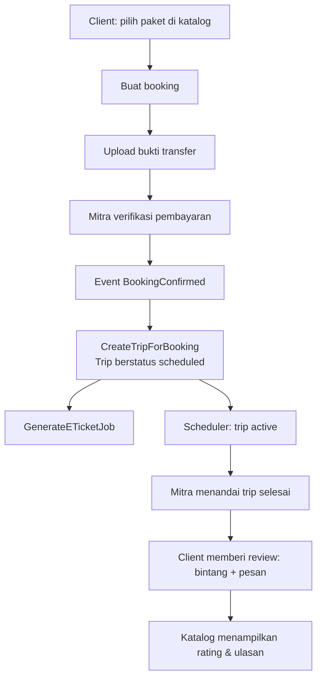

# SI-CANGKAL

Aplikasi pemesanan paket wisata berbasis web dengan tiga peran: **admin**, **mitra** (penyedia paket), dan **client** (pemesan). Client mencari paket di katalog, melakukan booking dan upload bukti transfer; mitra memverifikasi pembayaran dan menjalankan trip; admin memantau seluruh transaksi dan laporan.

## Arsitektur singkat



Alur request mengikuti lapisan:

`routes/web.php` → Controller per role → FormRequest → Policy → Service → Repository (Contracts + Eloquent) → Model.

Binding repository/service ada di `app/Providers/AppServiceProvider.php`. Auto-discovery event **dimatikan**; `BookingConfirmed` dipetakan eksplisit di `EventServiceProvider` ke `CreateTripForBooking` (sync). Listener itu membuat `Trip` + `TripDay`, lalu mengantrekan `GenerateETicketJob`.

Notifikasi in-app/Push FCM ditangani `NotificationDispatcher` (push diantrekan sebagai `SendPushNotificationJob`), bukan oleh listener event. Semua job antrean memakai `after_commit=true` agar tidak dijalankan sebelum transaksi database selesai.

## Tech stack

| Komponen         | Versi / catatan                                                       |
| ---------------- | --------------------------------------------------------------------- |
| PHP              | ^8.3                                                                  |
| Laravel          | 13                                                                    |
| Inertia.js       | v3                                                                    |
| Svelte           | 5 (runes saja: `$props`, `$state`, `$derived`, `$effect`)             |
| Tailwind CSS     | v4, dikonfigurasi di `resources/css/app.css` (`@theme`)               |
| Frontend tooling | **Vite+** (`vp`), bukan Vite biasa                                    |
| Package manager  | **Bun** (`bun.lock`) — bukan npm/pnpm                                 |
| Database         | **PostgreSQL 16 wajib** (migrasi memakai `jsonb`)                     |
| PDF              | DomPDF (Blade di `resources/views/pdf` dan `resources/views/reports`) |
| Notifikasi       | Firebase Cloud Messaging + tabel `notifications`                      |

## Quick start (lokal)

```bash
composer install
bun install
cp .env.example .env
php artisan key:generate

# Nyalakan PostgreSQL 16 (docker). Jalankan sekali → membuat sicangkal_db
# dan sicangkal_db_testing lewat docker/postgres/init/01-create-testing-db.sql
docker compose up -d pgsql

php artisan migrate
php artisan wayfinder:generate --with-form

# Jalankan semua proses: serve + queue:listen + pail + Vite+
composer dev
```

Aplikasi tersedia di `http://localhost:8000`.

> **Catatan queue:** jalankan queue worker saat mengerjakan E-Ticket atau notifikasi. `composer dev` sudah menjalankannya.

## Environment variables

Sumber kebenaran adalah `.env.example`. Variabel yang paling sering diubah:

| Variabel               | Default                                       | Keterangan                                 |
| ---------------------- | --------------------------------------------- | ------------------------------------------ |
| `APP_NAME`             | `SI-CANGKAL`                                  | Nama aplikasi                              |
| `APP_ENV`              | `local`                                       | `local` / `testing` / `production`         |
| `APP_URL`              | `http://localhost:8000`                       | Harus `localhost` untuk E2E                |
| `APP_TIMEZONE`         | `Asia/Makassar`                               | **Diabaikan**—zona aplikasi hardcode `UTC` |
| `DB_*`                 | `127.0.0.1:5432`, `sicangkal_db`              | Database utama                             |
| `E2E_DB_*`             | `sicangkal_db_testing`                        | Database khusus Playwright                 |
| `BREVO_API_KEY`        | kosong                                        | Pengirim email transaksional               |
| `FIREBASE_CREDENTIALS` | `storage/app/firebase/firebase-adminsdk.json` | Service account FCM (gitignored)           |
| `VITE_FIREBASE_*`      | kosong                                        | Konfigurasi Firebase sisi client           |
| `GOOGLE_CLIENT_*`      | kosong                                        | Login Google OAuth                         |
| `AUTH_THROTTLE_*`      | lihat `.env.example`                          | Batas percobaan login/register/dll.        |
| `DOKU_*`               | lihat bagian Sandbox DOKU                     | Payment gateway sandbox (Fase 1)           |

Zona waktu: DB menyimpan **UTC**. Untuk logika "hari ini"/"sekarang" pakai `App\Support\Timezone`, **jangan** `now()` langsung. Timezone user/trip berformat IANA; default `Asia/Makassar`.

### Sandbox DOKU (Fase 1)

Fase 1 hanya memakai **sandbox**. Semua kode membaca kredensial lewat `config('payment.doku.*')`; satu-satunya tempat yang memanggil `env('DOKU_...')` adalah `config/payment.php`.

Yang perlu disiapkan di dashboard sandbox (`sandbox.doku.com`):

1. Ambil **Client ID** dan **Active Secret Key** di **Integrations > API Keys**. `DOKU Public Key` dan `Merchant Public Key` belum dipakai.
2. Aktifkan kanal QRIS, VA (BCA/Mandiri/BRI/BNI), dan e-wallet (DANA/OVO/ShopeePay) di **Settings > Payment Settings**.
3. Aktifkan **Split Settlement** di **Setting > Service**, lalu daftarkan rekening mitra di **Setting > Bank Account**. `Bank Settlement ID` disimpan per mitra di database, bukan di `.env`.
4. Set Notification URL dengan path `/payments/doku/webhook` untuk tiap kanal yang dipakai.

Karena DOKU **melarang ngrok** dan tidak dapat mengirim notifikasi ke `localhost`, gunakan tunnel:

```bash
# terminal 1
php artisan serve

# terminal 2
bash scripts/doku-tunnel.sh
# akan menampilkan https://<id>.lhr.life
```

Salin URL tersebut ke `DOKU_NOTIFICATION_URL` dengan akhiran `/payments/doku/webhook`. URL gratis bersifat sementara; perbarui `.env` setiap kali tunnel dibuka ulang. Set `DOKU_SANDBOX_ENABLED=true` hanya jika ingin menjalankan E2E sandbox.

Verifikasi konfigurasi:

```bash
php artisan config:show payment
grep -rn "env('DOKU_" app routes resources tests --include='*.php' --include='*.ts' --include='*.svelte'
```

Perintah `grep` harus menghasilkan **kosong**.

Alur sandbox Fase 1:

1. Client/bagian manual membuat booking `pending_payment`.
2. Client memilih **Bayar dengan DOKU** (atau mitra membuat payment link).
3. Link checkout diakses dari simulator: `https://sandbox.doku.com/integration/simulator/`.
4. Webhook `POST /payments/doku/webhook` diverifikasi signature-nya, lalu booking menjadi `confirmed`.
5. Dana ditahan (`hold_settlement`) dan split ke rekening mitra.
6. Setelah mitra menyelesaikan trip, `ReleaseDokuSettlementJob` melepas dana; dana tiba H+1.
7. Refund gateway memakai Refund API DOKU; bila issuer menolak, status refund tetap `PENDING` dan dijadwalkan ulang.

E2E `e2e/payment/doku-sandbox.spec.ts` otomatis **skip** kecuali `DOKU_SANDBOX_ENABLED=true`. Pastikan `.env.testing`/shell juga memiliki kredensial sandbox, tunnel aktif, dan `DOKU_E2E_SETTLEMENT_BANK_ACCOUNT_ID` sesuai rekening yang didaftarkan di dashboard sandbox.

## Testing & quality gate

```bash
# Backend
php artisan test                      #seluruh Pest
php artisan test --filter=BookingControllerTest
composer test                         #config:clear -> Pint -> PHPStan -> Pest

# Frontend
bun run test                          #Vitest (jsdom)
bun run check                         #format + lint (type-aware)
bun run types:check                   #svelte-check — beda dengan composer types:check
composer types:check                  #PHPStan level 7

# E2E — WAJIB build dulu karena Playwright menyajikan public/build
bun run build
bun run test:e2e
bun run test:e2e e2e/auth/login.spec.ts --project=chromium
bun run test:e2e:shard:4
bun run test:e2e:rate-limit

# E2E sandbox DOKU (opsional, butuh tunnel + kredensial sandbox)
bun run test:e2e e2e/payment/doku-sandbox.spec.ts --project=chromium
```

`bun run check` **bukan** `svelte-check`; keduanya harus dijalankan. Komponen di `resources/js/components/ui/*` dikecualikan dari format/lint Vite+.

Sebelum selesai mengerjakan fitur backend/frontend, jalankan: `bun run check`, `bun run types:check`, `bun run test`, dan `composer test`.

### CI otomatis

Perintah tersebut juga dijalankan GitHub Actions setiap push/PR ke `main`:

- `.github/workflows/tests.yml` — Pint, PHPStan, `bun run check`, `bun run types:check`, Pest (dengan Postgres 16), Vitest, dan audit dependency
- `.github/workflows/e2e.yml` — Playwright chromium/firefox/webkit + rate-limit, lengkap dengan upload report

`.github/dependabot.yml` memantau pembaruan GitHub Actions, Composer, JavaScript/Bun, dan Docker setiap minggu.

### Catatan E2E

- `.env.testing` sudah ter-commit dan dipakai Pest serta E2E.
- Playwright menyalakan `php -S` sendiri di `http://localhost:8000` dan **menolak** server yang sudah berjalan.
- Host harus `localhost`, **bukan** `127.0.0.1` (support check FCM).
- Butuh klien `psql` dan user DB dengan hak `CREATEDB`.
- Butuh file service account Firebase di `storage/app/firebase/` (gitignored; CI menulis dummy).
- `QUEUE_CONNECTION=sync` dipaksakan agar generasi E-Ticket deterministik—jangan diubah.
- WebKit hanya berjalan saat `CI=true`.
- Endpoint `/_test/*` hanya ada saat `APP_ENV=testing`.
- Detail lengkap: [`e2e/README.md`](e2e/README.md).

## Struktur direktori inti

```
app/
├── Enums/                     # status & label (BookingStatus, TripStatus, ...)
├── Http/
│   ├── Controllers/{Admin,Mitra,Client}/
│   ├── Requests/              # FormRequest per aksi
│   └── Resources/             # shape JSON ke frontend
├── Models/
├── Policies/
├── Repositories/
│   ├── Contracts/
│   └── Eloquent/
├── Services/<Domain>/
├── Support/                   # Timezone, LikeEscaper, AuditLogger
└── Providers/
database/
├── migrations/
├── factories/
└── seeders/
resources/
├── js/
│   ├── pages/<Role>/          # halaman Inertia (nama = path)
│   ├── api/                   # wrapper URL manual untuk router
│   ├── utils/enums/           # mirror label/status dari PHP
│   └── types/                 # mirror tipe
├── css/app.css
└── views/{pdf,reports}/       # template DomPDF
routes/web.php
tests/                         # Pest (Feature + Unit)
e2e/                           # Playwright
docker/postgres/init/          # inisialisasi DB testing saat container pertama dibuat
```

Dua aturan frontend yang mudah terlewat:

- Halaman Inertia memakai nama **path-based**, mis. `Inertia::render('Client/Bookings/Show')`.
- File di `resources/js/{actions,routes,wayfinder}` dihasilkan Wayfinder dan **gitignored**—jangan diedit. Regenerate setelah route/controller berubah dengan `php artisan wayfinder:generate --with-form`.

## Deployment singkat

```bash
bun run build
php artisan config:cache
php artisan route:cache
php artisan view:cache
php artisan migrate --force
```

Pastikan `APP_DEBUG=false`, HTTPS dipaksakan otomatis di production, dan password admin seeder tercatat di kanal log `audit` (atau diatur lewat `ADMIN_PROD_PASSWORD`).
